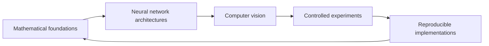

### Deep Learning Research Engineer · Computer Vision

**Research-minded engineering grounded in mathematical understanding and careful experimentation.**

---

## About me

I work across deep learning research and practical machine learning engineering, with a focus on computer vision. I am especially interested in understanding what happens inside neural networks: how their mathematical structure, optimization choices, and training dynamics affect the behavior of a model.

My approach combines studying the theory, implementing ideas, and evaluating them through disciplined experiments. I enjoy taking a research concept from paper to working code, then examining its assumptions, behavior, and limitations. I aim to make implementations clear, modular, and reproducible so that results can be understood and built upon.

### How I approach a problem

| Understand | Implement | Experiment | Improve |
| :---: | :---: | :---: | :---: |
| Read the relevant theory and research | Build a clear, modular baseline | Track controlled runs and evaluate results | Refine performance, reliability, and clarity |

## Areas of expertise

### Deep learning and neural networks

My interests span the fundamentals of neural networks and the practical details that shape model performance and stability:

- **Network fundamentals:** neural networks, convolutional neural networks (CNNs), forward propagation, and backpropagation
- **Learning and optimization:** loss functions, gradient descent, gradient analysis, and optimization behavior
- **Training stability:** vanishing and exploding gradients, gradient clipping, weight initialization, and Kaiming initialization
- **Model components:** batch normalization and convolutional architectures
- **Evaluation and generalization:** accuracy, precision, recall, F1 score, model evaluation, and generalization
- **Efficiency:** computational efficiency and efficient deep learning methods

### Computer vision

I focus on visual learning tasks and the pipeline around them, from preparing input data to evaluating a trained model:

- Image classification and handwritten digit recognition
- CNN-based image classification
- Image processing, preprocessing, and feature extraction
- Building computer vision pipelines
- Evaluating classification results and model behavior

### Mathematical and scientific foundations

I am interested in the mathematics that supports machine learning and helps explain why models learn as they do:

- Linear algebra, calculus, probability, and statistics
- Mathematical foundations of machine learning and deep learning
- Optimization methods and learning dynamics
- Numerical computation and the behavior of gradients

### Research and experimentation

I value evidence-driven development and systematic evaluation. My research workflow includes studying papers and technical references, forming testable questions, comparing controlled experiments, tracking configurations, and documenting results so that work can be repeated and reviewed.

## Technical toolkit

| Category | Technologies and tools |
| --- | --- |
| **Programming** | Python, C#, JavaScript, HTML, CSS |
| **Deep learning** | PyTorch, Torchvision, Torchinfo |
| **Scientific computing** | NumPy, Pandas, Matplotlib, scikit-learn |
| **Experimentation** | Weights & Biases, Jupyter Notebook, Google Colab |
| **Systems and workflow** | Linux, Docker, CUDA, Git, GitHub, terminal |

## Selected projects

<table>
<tr>
<td width="33%" valign="top">

<h3 align="center"><a href="https://github.com/aliasgharebrahimi/MNISTVision">MNISTVision</a></h3>

A handwritten digit recognition project built around a custom neural network architecture. The work explores classification performance, computational efficiency, fast inference, and experimental optimization.

**Focus:** architecture design · model optimization · hyperparameter tuning 
**Stack:** Python · PyTorch · Weights & Biases

</td>
<td width="33%" valign="top">

<h3 align="center"><a href="https://github.com/aliasgharebrahimi/Axiom">Axiom</a></h3>

A mathematical learning resource built around the foundations of deep learning. It connects core ideas with practical explanations and implementations.

**Topics:** linear algebra · calculus · optimization · statistics · probability 
**Stack:** Python · PyTorch · NumPy · Matplotlib

</td>
<td width="33%" valign="top">

<h3 align="center"><a href="https://github.com/aliasgharebrahimi/MNISVision-Numpy">MNISVision-Numpy</a></h3>

A from-scratch handwritten digit recognition implementation using NumPy. The project makes the core computations of a neural network explicit without relying on a deep learning framework.

**Focus:** neural network internals · CNNs · numerical computation 
**Stack:** Python · NumPy

</td>
</tr>
</table>

## Research interests

- **Deep learning foundations:** the mathematical principles and theoretical ideas underlying learning algorithms
- **Neural network architectures:** how model structure and learning mechanisms influence behavior
- **Computer vision:** visual representation learning, image understanding, and modern vision approaches
- **Optimization and dynamics:** training behavior, stability, and generalization
- **Research translation:** studying new methods and testing them through practical implementations

## Engineering principles

| Principle | What it means in practice |
| --- | --- |
| **Mathematical rigor** | Understand the assumptions and foundations behind the methods being implemented. |
| **Research-driven development** | Use papers, technical documentation, and investigation to guide engineering decisions. |
| **Experimental discipline** | Change variables systematically, track configurations, and evaluate with appropriate metrics. |
| **Clean architecture** | Keep components modular, maintainable, and easy to extend. |
| **Reproducibility** | Make experiments, code, and results traceable and repeatable. |
| **Transparent reporting** | Describe results honestly, including limitations and trade-offs. |

## GitHub activity

## Current focus

I am currently improving `MNISVision-Numpy` while deepening my understanding of deep learning through hands-on implementation, controlled experimentation, and research paper review. I am particularly interested in connecting the mathematical view of a model with its observed training behavior.

## Collaboration

I am open to collaborating on projects involving deep learning, computer vision, neural network implementation, and AI engineering. I also enjoy discussions that connect theory, experimental results, and practical software design.

For professional inquiries or technical discussions, [get in touch by email](mailto:aliasghare1.ai@gmail.com).

*Research · Engineering · Experimentation*

