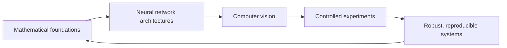

### Deep Learning Research Engineer · Computer Vision

I study how deep learning models work, explore neural network architectures, and turn research ideas into robust, reproducible implementations.

---

## About

My work sits at the intersection of mathematical understanding, experimental research, and practical AI engineering. I enjoy reading papers, investigating difficult problems in neural networks, and building modular systems whose experiments and results can be reproduced.

## Areas of expertise

<table>
<tr>
<td width="50%" valign="top">

### Deep learning

- Neural networks and convolutional neural networks (CNNs)
- Mathematical foundations of machine learning
- Forward propagation, backpropagation, and loss functions
- Optimization, gradient descent, and gradient analysis
- Vanishing and exploding gradients; gradient clipping
- Weight initialization, including Kaiming initialization
- Batch normalization and training stability
- Training dynamics, model evaluation, and generalization
- Efficient deep learning
- Classification metrics: accuracy, precision, recall, and F1 score

</td>
<td width="50%" valign="top">

### Computer vision

- Image classification and handwritten digit recognition
- CNN-based image classification
- Image processing and preprocessing
- Feature extraction
- Computer vision pipelines
- Model evaluation

</td>
</tr>
<tr>
<td width="50%" valign="top">

### Scientific computing and experimentation

- NumPy, Pandas, Matplotlib, and scikit-learn
- Experiment tracking with Weights & Biases
- Jupyter Notebook and Google Colab
- Research paper review and controlled experimentation

</td>
<td width="50%" valign="top">

### Software and infrastructure

- **Languages:** Python, C#, JavaScript, HTML, CSS
- **Deep learning:** PyTorch, Torchvision, Torchinfo
- **Systems:** Linux, Docker, CUDA
- **Workflow:** Git, GitHub, terminal

</td>
</tr>
</table>

### Tools I use

## Selected projects

<table>
<tr>
<td width="33%" valign="top">

<h3 align="center"><a href="https://github.com/aliasgharebrahimi/MNISTVision">MNISTVision</a></h3>

Handwritten digit recognition with a custom neural network. Focus areas include accuracy, efficient inference, model optimization, and systematic experimentation.

**Stack:** Python · PyTorch · Weights & Biases

</td>
<td width="33%" valign="top">

<h3 align="center"><a href="https://github.com/aliasgharebrahimi/Axiom">Axiom</a></h3>

A mathematical learning resource for deep learning, covering linear algebra, calculus, optimization, statistics, and probability through explanations and practical implementations.

**Stack:** Python · PyTorch · NumPy · Matplotlib

</td>
<td width="33%" valign="top">

<h3 align="center"><a href="https://github.com/aliasgharebrahimi/MNISVision-Numpy">MNISVision-Numpy</a></h3>

A from-scratch handwritten digit recognition model using NumPy to explore neural network computations without a deep learning framework.

**Stack:** Python · NumPy

</td>
</tr>
</table>

## Research interests

- Deep learning theory and the mathematical principles behind learning algorithms
- Neural network structures, learning mechanisms, and architecture design
- Visual representation learning and image understanding
- Optimization, training dynamics, and model stability
- Evaluating research methods and translating them into practical systems

## GitHub charts

## Engineering principles

| Reproducible | Modular | Reliable | Transparent | Research-driven |
| :---: | :---: | :---: | :---: | :---: |
| Traceable experiments | Maintainable components | Careful evaluation | Honest reporting | Decisions grounded in evidence |

## Current focus

Improving `MNISVision-Numpy` and strengthening my understanding of deep learning through implementation, experiments, and research papers.

## Collaboration

I’m interested in working on deep learning, computer vision, and AI engineering projects. For professional inquiries and technical discussions, [send me an email](mailto:aliasghare1.ai@gmail.com).

*Research · Engineering · Experimentation*

